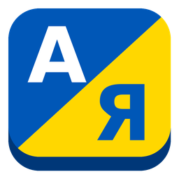

# KeySW

Автоматичне перемикання розкладки для Windows і macOS, відкритий аналог Punto Switcher.
Набрали `ghbdsn` в англійській розкладці? KeySW виправить на `привіт` і перемкне мову.

*Automatic keyboard layout switcher for Windows and macOS (English ↔ Ukrainian / Russian), an open-source Punto Switcher alternative. English below.*

## Як це працює

- Англійська → українська або російська: обирається та кирилична розкладка, якою ви користувались **останньою**.
- Українська / російська → англійська.
- Рішення приймається для кожного слова після пробілу: спершу словник (30 000 найчастіших слів кожної мови), потім статистика сполучень літер (триграми), щоб розпізнавати й слова, яких немає в словнику.
- Не чіпає слова з цифрами, змішаний регістр (`iPhone`), одиночні літери та поширені скорочення (`db`, `ui`, `ok` …).
- **Скасування автозаміни: двічі швидко натисніть Shift** одразу після виправлення. Повернеться набране слово і попередня розкладка, і до кінця сеансу це слово більше не виправлятиметься. Опційно можна ввімкнути скасування клавішею Backspace.
- Усе працює локально, набраний текст нікуди не надсилається.

## Стан

| Частина | Стан |
|---|---|
| Ядро розпізнавання (`crates/keysw-core`) | ✅ готово, з тестами |
| Програма для Windows (`crates/keysw-win`) | 🧪 перша версія, тестуємо |
| Програма для macOS | ⏳ |
| Збірки в Releases | ⏳ |

## Windows

Запустіть `keysw-win.exe`: у треї з'явиться значок  (сірий, коли вимкнено).

- Під час першого запуску KeySW запропонує **автозапуск**. Він реєструє завдання в Планувальнику завдань, яке запускає програму з правами адміністратора під час входу в Windows. Тоді розкладка перемикається й у вікнах, відкритих від адміністратора. Windows один раз попросить дозвіл. Програма копіюється в `%LOCALAPPDATA%\Programs\KeySW`, тож завантажений файл можна видалити.
- Меню значка (права кнопка): увімкнути/вимкнути автоперемикання, автозапуск, «Перезапустити з правами адміністратора», вихід. Подвійний клік по значку вмикає/вимикає.
- Скасувати автозаміну: двічі швидко натисніть Shift одразу після неї.
- Потрібні встановлені розкладки English і Українська (та/або Русский).

Зібрати самому: `cargo build --release -p keysw-win` (на Windows). Іконки генерує `tools/make_icons.py`.

## Спробувати ядро

Потрібен [Rust](https://rustup.rs).

```sh
cargo run --release -p keysw-cli -- ghbdsn ckfdf            # → привіт слава
cargo run --release -p keysw-cli -- --last ru ghbdtn         # → привет
cargo run --release -p keysw-cli -- --layout uk руддщ цщкдв  # → hello world
echo "Z gbie yjde ghjuhfve" | cargo run --release -p keysw-cli  # → Я пишу нову програму
```

`--explain` показує, на основі чого прийнято рішення.

## Розробка

```sh
cargo test --release
# якість на словах, яких немає в словнику:
cargo run --release -p keysw-core --example eval -- en words_en.txt uk words_uk.txt ru words_ru.txt
```

Словники у `crates/keysw-core/data/` згенеровані `tools/build_dict.py` зі списків
[hermitdave/FrequencyWords](https://github.com/hermitdave/FrequencyWords) (OpenSubtitles 2018, CC-BY-SA-4.0).
З українського списку відфільтровано російські слова, які потрапили туди із субтитрів.

---

## English

KeySW watches what you type and, when a word was clearly typed in the wrong layout,
replaces it and switches the layout. Double-tap Shift right after a correction to
undo it (the word is then left alone for the rest of the session). English-layout mistakes go to whichever Cyrillic
layout (Ukrainian or Russian) you used last; Cyrillic-layout mistakes go to English.

The core engine (`crates/keysw-core`) is pure Rust with no OS dependencies: a
word-frequency dictionary plus a character trigram model per language. The Windows
and macOS apps (in progress) feed it key presses and apply the corrections it returns.

Try it: `cargo run --release -p keysw-cli -- ghbdsn` prints `привіт`.

Code is MIT-licensed. The word lists are derived from
[FrequencyWords](https://github.com/hermitdave/FrequencyWords) (OpenSubtitles, CC-BY-SA-4.0).
